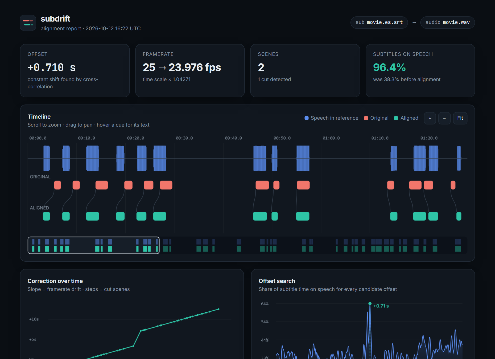
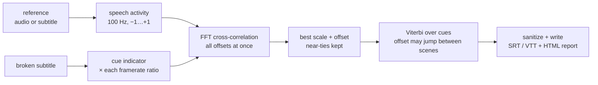

# 🎬 subdrift

[](https://github.com/ardazeybek-dev/subdrift/actions/workflows/ci.yml)
[](https://fsharp.org/)
[](LICENSE)
[](https://ardazeybek-dev.github.io/subdrift/)

**Fix out-of-sync subtitles automatically — constant delays, framerate drift and cut scenes — with signal processing instead of trial and error.**

You downloaded a subtitle and it is *almost* right: two seconds late at the start, five seconds late by the end, and completely off after the scene the TV edit removed. Shifting by hand in your player fixes one of these at a time. `subdrift` fixes all three in one pass, and shows you exactly what it did.

<p align="center">
  <a href="https://ardazeybek-dev.github.io/subdrift/"></a>
</p>

```text
$ subdrift sync movie.es.srt movie.mkv --report report.html

▍subdrift · subtitle alignment
  • subtitle       41 cues · utf-8
  • reference      5 min audio · 30% speech · 117 ms
  • aligned        323 ms

  offset             +0.710 s
  framerate          25 → 23.976 fps  (×1.04271)
  scenes             2 segments · 1 cut detected
                     cues 1–19  −2.530 s
                     cues 20–41  +0.700 s
  on speech before   █████████░░░░░░░░░░░░░░░  38.3%
  on speech after    ███████████████████████░  96.4%
```

## ✨ What it does

| Problem | How subdrift handles it |
| --- | --- |
| Subtitle starts too early / late | FFT cross-correlation over every offset within ±2 min, in one shot |
| Drift that grows over the movie (PAL 25 fps ↔ film 23.976 fps, NTSC 29.97, …) | Scores every common framerate ratio and re-ranks near-ties after refinement |
| Jump after a removed scene or ad break | Viterbi pass over the cues: the offset may change between scenes, at a cost |
| Only have a subtitle in **another language** that is correctly timed | Uses its timing as the reference, so no audio is needed |
| Old `windows-125x` files that turn into `çö` | Strict UTF-8 first, configurable legacy fallback, always writes clean UTF-8 |
| "Did it actually work?" | Interactive HTML report: timeline, correction curve, offset search, scenes |

**References it accepts:**
- a correctly timed `.srt` / `.vtt`, in any language
- a `.wav` file, decoded natively
- any video or audio file (`.mkv`, `.mp4`, `.opus`, …), as long as [ffmpeg](https://ffmpeg.org/) is installed

## 🚀 Quick start

Requires the [.NET 10 SDK](https://dotnet.microsoft.com/download).

```bash
git clone https://github.com/ardazeybek-dev/subdrift.git
cd subdrift
dotnet run -c Release --project src/Subdrift.Cli -- demo
```

`demo` generates 5 minutes of synthetic dialogue, a correct English subtitle and a broken Spanish one (PAL timing, +2.4 s delay, −3.1 s jump after a cut). It then repairs the Spanish file and writes `subdrift-demo/report.html`.

Install it as a global command:

```bash
dotnet pack src/Subdrift.Cli -c Release -o ./nupkg
dotnet tool install --global --add-source ./nupkg subdrift
subdrift --help
```

Or use Docker, which bundles ffmpeg:

```bash
docker build -t subdrift .
docker run --rm -v "$PWD:/work" subdrift sync movie.srt movie.mkv -r report.html
```

## 🧭 Usage

```text
subdrift sync  <subtitle> <reference> [options]   align a subtitle
subdrift shift <subtitle> <seconds> [-o <file>]   manual constant shift
subdrift info  <subtitle>                         stats, overlaps, reading speed
subdrift demo  [directory]                        generate and repair a sample
```

| Option | Default | Meaning |
| --- | --- | --- |
| `-o, --output <file>` | `<name>.synced.<ext>` | Output path. The extension picks SRT or VTT |
| `-r, --report <file>` | – | Write the interactive HTML report |
| `--max-offset <s>` | `120` | Largest constant offset to search |
| `--split-penalty <s>` | `6` | Cost of one scene jump, in seconds of matched speech |
| `--max-split <s>` | `60` | Largest extra shift one scene may get |
| `--vad-threshold <x>` | `0.35` | Speech threshold, 0 = noise floor, 1 = loud speech |
| `--encoding <name>` | `windows-1252` | Fallback for non-UTF-8 input, e.g. `windows-1254` |
| `--no-framerate` | | Search a constant offset only |
| `--no-split` | | One offset for the whole file |
| `--json` | | Machine-readable result on stdout, for scripts |

Exit codes: `0` success · `1` usage error · `2` unreadable input.

## ⚙️ Configuration

Every option can also be set through the environment or a `.env` file in the working directory. Copy [`.env.example`](.env.example) to get started. Precedence is **flag › environment variable › `.env` › default**.

| Variable | Purpose |
| --- | --- |
| `SUBDRIFT_FFMPEG` | Path to ffmpeg (only for non-WAV media) |
| `SUBDRIFT_FALLBACK_ENCODING` | Legacy encoding for non-UTF-8 subtitles |
| `SUBDRIFT_MAX_OFFSET` | Same as `--max-offset` |
| `SUBDRIFT_SPLIT_PENALTY` | Same as `--split-penalty` |
| `SUBDRIFT_MAX_SPLIT` | Same as `--max-split` |
| `SUBDRIFT_VAD_THRESHOLD` | Same as `--vad-threshold` |
| `NO_COLOR` | Disable ANSI colors ([no-color.org](https://no-color.org)) |

## 🔬 How it works



1. **Speech activity.** Audio is cut into 10 ms frames. Log energy is taken after a pre-emphasis filter, so low rumble and music beds count less than voice. It is averaged in the *linear* domain over ±100 ms, which bridges the quiet gaps between syllables. A soft threshold is placed between the noise floor (10th percentile) and loud speech (95th percentile), giving a value in `[-1, 1]` per frame. A subtitle reference simply becomes `+1` inside cues and `−1` outside.
2. **Global search.** The broken subtitle becomes a 0/1 indicator. For each framerate ratio (23.976 / 24 / 25 / 29.97 / 30 in every direction) its correlation with the reference is computed for every lag at once: `IFFT(FFT(ref) · conj(FFT(sub)))`. The score is *the share of subtitle time that lands on speech*. Silence pulls it down, so a subtitle cannot cheat by covering everything.
3. **Near-tie re-ranking.** 25→24 and 25→23.976 differ by only 0.1 %. Every candidate within two points of the best is refined in full, and the best final result wins.
4. **Scene cuts.** A Viterbi pass runs over the cues. The states are extra shifts of ±60 s at 10 ms steps. Staying on the same shift is free; jumping costs `split-penalty` seconds of matched speech. Prefix sums make each cue's score O(1), so one pass is `O(cues × states)`.
5. **Sanitize.** Overlaps created at segment boundaries are trimmed, and cues pushed before 0:00 are dropped.

On a 2-hour, 1239-cue film with a PAL conversion and a 12 s cut, alignment against a subtitle reference takes about 2 s and goes from 43.6 % to 99.9 % of subtitle time on speech.

## 🗂 Project structure

```text
subdrift/
├── src/
│   ├── Subdrift.Core/          # the library
│   │   ├── Subtitle.fs         # SRT/VTT parse + render, encoding detection, sanitize
│   │   ├── Signal.fs           # 100 Hz activity timelines, prefix sums, coverage
│   │   ├── Fft.fs              # radix-2 FFT, cross-correlation
│   │   ├── Audio.fs            # WAV decoder, ffmpeg pipe, voice activity detection
│   │   ├── Align.fs            # global search, near-tie re-ranking, Viterbi segments
│   │   ├── Synth.fs            # deterministic synthetic dialogue + broken subtitles
│   │   ├── Report.fs           # report data model
│   │   └── report.html         # report template (embedded resource)
│   └── Subdrift.Cli/           # the `subdrift` command
│       ├── Config.fs           # flags › env › .env › defaults
│       ├── Term.fs             # ANSI output, NO_COLOR aware
│       └── Program.fs          # commands: sync, shift, info, demo
├── tests/Subdrift.Tests/       # xUnit: parsing, FFT, offset/framerate/cut recovery, audio
├── docs/                       # GitHub Pages live report + screenshots
├── .github/workflows/ci.yml    # Linux / Windows / macOS + ffmpeg end-to-end
├── Dockerfile                  # runtime image with ffmpeg
└── .env.example
```

## 🧪 Development

```bash
dotnet build
dotnet test                      # 19 tests, ~10 s
dotnet run --project src/Subdrift.Cli -- demo out
```

CI builds and tests on Linux, Windows and macOS. A separate job encodes the demo audio to Opus with ffmpeg and checks that alignment through the ffmpeg path reaches more than 90 % coverage.

## ⚠️ Gotchas

- **Wrong framerate picked on short clips** → 0.1 % ratios are hard to tell apart over a few minutes → give it the full-length file, or pass `--no-framerate` if you know there was no conversion.
- **Splits a file that has no cuts** → noisy reference or very sparse dialogue → raise `--split-penalty`, or pass `--no-split`.
- **Very low "on speech" after alignment, with a warning** → the reference is a different cut or a different episode → check the reference; subdrift cannot fix a mismatched pair.
- **Accents broken in the output** → input is a legacy code page other than the fallback → set `--encoding windows-1254` (Turkish), `windows-1251` (Cyrillic), etc.
- **Music-heavy scenes align poorly** → the energy VAD hears loud score as speech → raise `--vad-threshold`, or align against a subtitle in another language.

## 📄 License

[MIT](LICENSE) © Arda Zeybek
